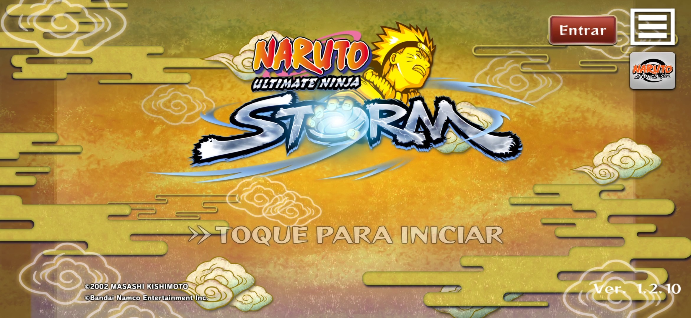
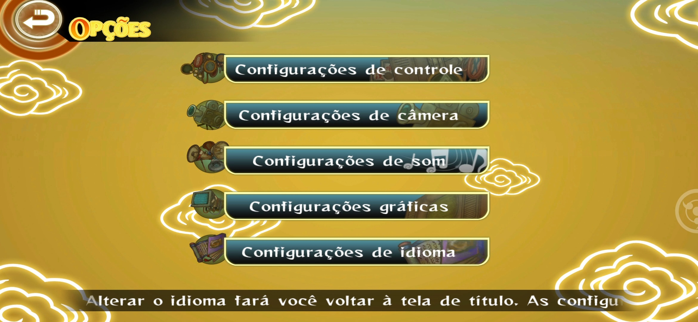
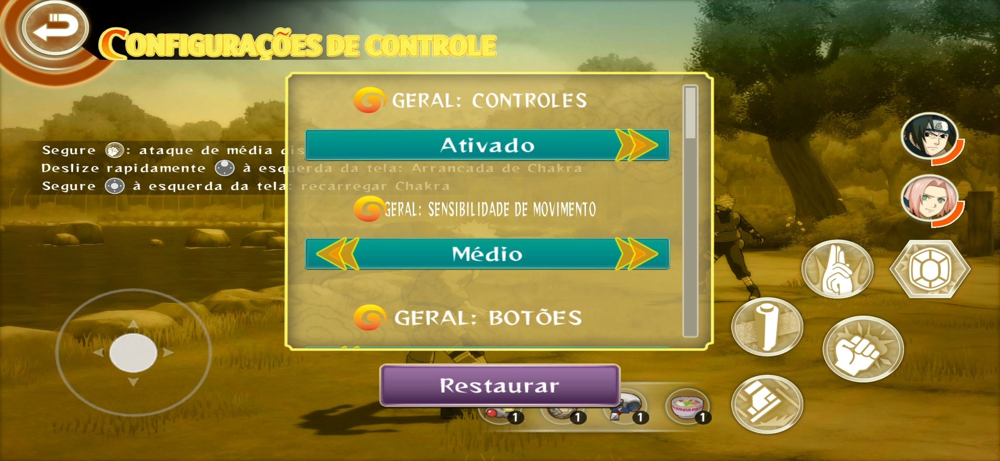
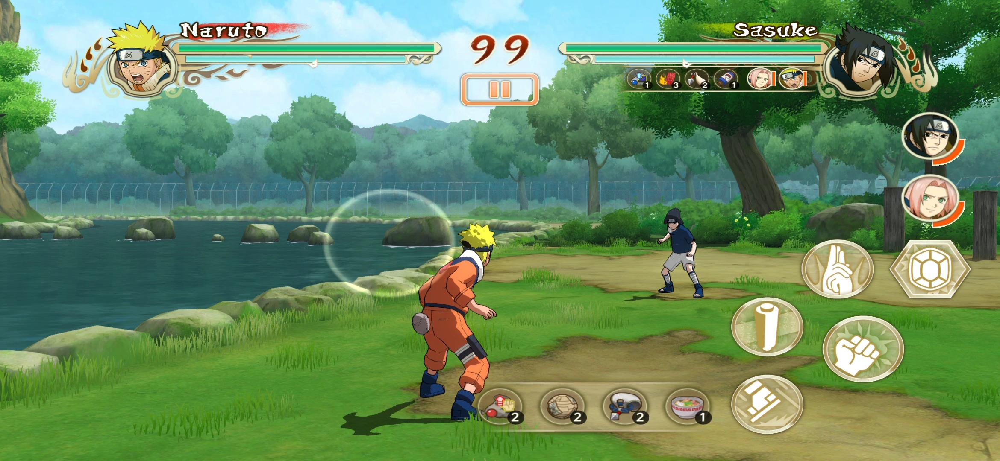
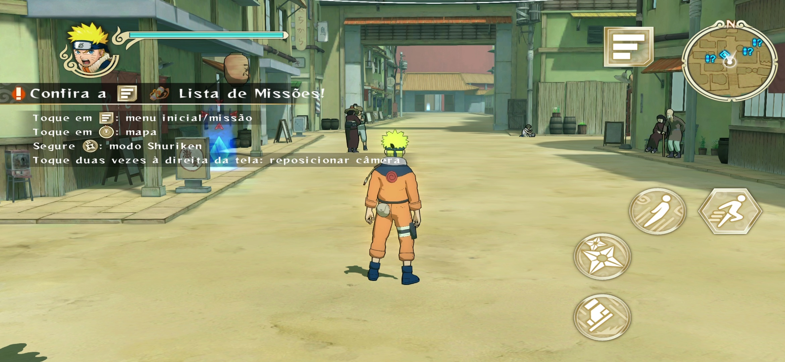

# Naruto Storm Mobile Fix Exynos

Correções e documentação para **Naruto: Ultimate Ninja Storm** no Android: patch Exynos, widescreen, português (Brasil) e suporte ao GameSir-X5 Lite validado no Galaxy S24.

A base ativa é o APK único **1.2.10** (`versionCode 38`).

## Galeria

<table>
  <tr>
    <td align="center"><br><sub>Tela de título</sub></td>
    <td align="center"><br><sub>Seleção de modo</sub></td>
    <td align="center"><br><sub>Menu de opções</sub></td>
  </tr>
  <tr>
    <td align="center"><br><sub>Configurações de controle</sub></td>
    <td align="center"><br><sub>Batalha</sub></td>
    <td align="center"><br><sub>Vila com missão</sub></td>
  </tr>
</table>

## Estado atual

- Correção de composição widescreen instalada no Galaxy S24 (SM-S921B) por atualização ADB, sem desinstalar nem limpar dados.
- O usuário confirmou após abrir o jogo: a margem lateral e o desalinhamento dos toques foram corrigidos.
- Instalação atual: versão 1.2.10, código 38, com pt-BR/inglês, widescreen e gamepad, sem logs de diagnóstico. Os APKs anteriores foram preservados para retorno.
- SHA-256 do APK instalado: `A9288675A6D66B235349F1B20B81E9ADF95CD9FA6AEB69B2811138D14BFD32FD`.
- Aceites: [composição widescreen](docs/WIDESCREEN_COMPOSITION_VALIDATION_20261026.md) e [controle no S24](docs/CONTROLLER_S24_VALIDATION_20261027.md). O usuário confirmou menus, batalha, reconexão e funcionamento da versão sem logs.

A aceitação é limitada ao S24 em 2340×1080 e ao GameSir-X5 Lite. Outras proporções, controles e o jogo completo não foram homologados. Houve uma falha Vulkan na primeira abertura da versão final; a reabertura funcionou, mas a causa dessa ocorrência permanece em aberto no relatório de controle.

## Recursos

| Recurso | Situação |
|---|---|
| **Correção Exynos** | Aplicada e verificada por hash. Entra sempre nas builds. |
| **Widescreen** | Validado somente no Galaxy S24 em 2340×1080. Outras proporções não foram testadas. |
| **Português (Brasil)** | Incluído nos textos e letreiros. Dublagem e algumas artes continuam no idioma original. |
| **Controle externo** | Validado no S24 com GameSir-X5 Lite: menus, batalha e reconexão. O build seletivo reaplica o patch com `--controller-base-apk ... --controls` sobre a base S24 identificada por hash. |

Uma variante mantém português e coloca inglês no lugar de francês. O usuário confirmou o funcionamento do inglês no S24; veja a construção e os limites em [Inglês no espaço do francês](docs/ENGLISH_NO_FRANCES.md).

## Para quem vai usar

Este repositório **não distribui o jogo**. Você precisa do seu próprio APK 1.2.10 (`versionCode 38`), obtido legalmente.

**Requisitos:** Windows com PowerShell, Python 3, Android SDK Build-Tools (`apksigner`, `zipalign`), ADB e um certificado de assinatura local criado por você.

Escolha só os ajustes que quiser com [`scripts/build-selective.py`](scripts/build-selective.py). A correção Exynos entra sempre, porque o widescreen depende dela.

O controle foi validado no S24 sobre a biblioteca widescreen de SHA `8797E444…`. Para reaplicar, use `--controller-base-apk` apontando para essa base e `--controls`; o caminho rejeita outra biblioteca. `--console-ui` oculta os controles táteis da batalha, preserva a lista de itens e troca triângulo/círculo por Y/B nos prompts Android de seleção. Essa troca é estática no APK, cobre apenas os dois glyphs existentes e ainda não muda ao conectar/desconectar o controle; a variante não foi instalada nem aceita no aparelho. Evidências: [controle no S24](docs/CONTROLLER_S24_VALIDATION_20261027.md#versão-sem-instrumentação) e [investigação da interface de console](docs/CONTROLLER_CONSOLE_UI_INVESTIGATION_20261027.md).

```powershell
# só Exynos
python scripts/build-selective.py --apk "C:\caminho\Ultimate-Ninja-Storm-1.2.10.apk" --keystore K --ks-pass F

# Exynos + pt-BR
python scripts/build-selective.py --apk "C:\caminho\Ultimate-Ninja-Storm-1.2.10.apk" --keystore K --ks-pass F --ptbr

# Exynos + widescreen + pt-BR
python scripts/build-selective.py --apk "C:\caminho\Ultimate-Ninja-Storm-1.2.10.apk" --keystore K --ks-pass F --widescreen --ptbr
```

- O APK final vai para `build/Naruto Ultimate Ninja Storm.apk` e **substitui** o anterior. Use `--output` para outro destino.
- Os arquivos intermediários ficam em `work/build-tmp-*` e são apagados ao fim de cada execução.
- Sem `--keystore`/`--ks-pass`, use `--unsigned` para gerar um APK que não instala.
- `--apk` é obrigatório e pode estar em qualquer pasta. Não é preciso copiar o APK para `origin/`.

**Passos resumidos** (detalhes em [PTBR_WIDESCREEN.md](docs/PTBR_WIDESCREEN.md#construção)):

1. Tenha o seu APK original 1.2.10 em qualquer pasta.
2. Gere a build com o script acima.
3. Assine o APK com seu certificado e confira `apksigner verify` e `zipalign -c -P 16 4`.
4. Instale com `adb install --no-incremental -r --user 0`, sem desinstalar nem limpar dados.

> Não publique a chave de assinatura, a senha, APKs do jogo nem o conteúdo de `work/`.

## Comece por aqui

1. [Guia de pt-BR e widescreen](docs/PTBR_WIDESCREEN.md): fontes, construção, instalação e evidências.
2. [Base principal 1.2.10 e patch Exynos](docs/APK_UNICO_1_2_10.md): origem, patch nativo e limites.
3. [Patch Exynos 1.2.9/1.2.10](docs/EXYNOS_FIX.md): histórico técnico e diferenças entre distribuições.
4. [Progresso e histórico](docs/PROGRESS.md): sequência de investigações e validações.

## Mapa do projeto

| Caminho | Conteúdo |
|---|---|
| `patches/exynos/` | Probe nativo e diagnóstico Vulkan. |
| `patches/ptbr/catalogs/` | Catálogos de tradução com IDs e textos de origem. |
| `patches/widescreen/` | Stubs usados no patch de tela larga. |
| `scripts/` | Extração, inventário, patch, repack e preparação de texturas. |
| `docs/` | Guias de uso, evidências, limites e histórico. |
| `docs/screenshots/` | Capturas de tela da galeria acima. |
| `origin/` | APK original 1.2.10, se você quiser guardar uma cópia aqui. |
| `build/` | APK integrado aceito para uso no S24. |
| `assets/` | Arte versionada usada como referência ou entrada de patch. Índice em [assets/README.md](assets/README.md). |
| `work/` | Insumos temporários de extração, patch e assinatura. Inventários e textos extraídos do jogo ficam em `work/inventory/`. |

## Fluxo de trabalho

- Leia o guia da tarefa antes de executar scripts. Os scripts validam hashes, Build IDs, offsets e arquivos de entrada.
- Para pt-BR e widescreen, siga as etapas de [PTBR_WIDESCREEN.md](docs/PTBR_WIDESCREEN.md).
- Para o patch Exynos, siga [APK_UNICO_1_2_10.md](docs/APK_UNICO_1_2_10.md) e use a entrada original fora do repositório.
- Preserve a entrada canônica 1.2.10. Gere candidatos fora de `build/`.
- A chave de assinatura e a senha ficam em `work/signing/`. Nunca as adicione ao Git nem publique.

## Git e artefatos

O diretório é um repositório Git (branch `main`). O `.gitignore` exclui APKs, dados de trabalho e bytecode Python para evitar que artefatos grandes ou privados sejam adicionados por engano.
