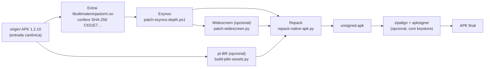
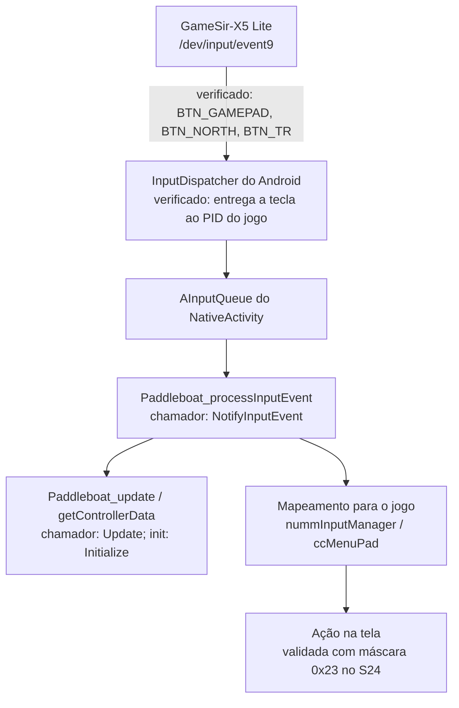

# Arquitetura

Escrito para: quem vai alterar os scripts de patch, investigar o binário nativo ou montar uma nova build.

## 1. Visão geral

O projeto não compila o jogo. Ele **modifica o APK 1.2.10 original** em etapas, cada uma com entrada e saída verificadas, e empacota o resultado.

## 2. Componentes

| Componente | Caminho | Responsabilidade |
|---|---|---|
| Orquestrador | `scripts/build-selective.py` | Escolhe os ajustes, chama as etapas, grava o manifesto `selective-build.json`. |
| Patch Exynos | `scripts/patch-exynos-depth.ps1` | Altera 1 byte da tabela de formatos de imagem, no offset do Build ID. |
| Patch widescreen | `scripts/patch-widescreen.py`, `patches/widescreen/stubs.S` | Insere código nativo para resolução, câmera e conversão de toque. |
| Textos pt-BR | `scripts/build-ptbr-assets.py`, `patches/ptbr/catalogs/` | Gera os arquivos de mensagem e letreiros substituídos no CPK. |
| Repacker APK | `scripts/repack-native-apk.py` | Troca só a biblioteca e os membros de substituição; confere CRC de todo o restante. |
| Repacker CPK | `scripts/patch-cpk.py` | Atualiza TOC e tamanho de conteúdo dos pacotes de áudio/dados. |
| Testes | `scripts/test-*.py` | Validam guardas e a composição do widescreen. |
| Entrada | `origin/` | APK original. Ignorada pelo Git. |
| Saída aceita | `build/` | Único APK aceito no S24. Ignorado pelo Git. |
| Trabalho | `work/` | Insumos, candidatos, análises e chave de assinatura. Ignorada pelo Git. |
| Evidência | `docs/` | Documentação e registros de análise. |

## 3. Invariantes

Estas regras valem para todo patch novo:

1. **Entrada identificada.** Antes de alterar, o script confere o SHA-256 da biblioteca ou o Build ID. Se não bater, aborta.
2. **Bytes esperados.** Antes de gravar, confere o valor que está no offset. Se for diferente, aborta.
3. **Intermediários isolados e limpos.** Cada etapa grava em `work/build-tmp-*`, que é apagada ao fim da execução. Só o APK final é publicado, substituindo o anterior em `build/` (ou no `--output` informado). A troca é feita por arquivo `.partial` seguido de `os.replace`.
4. **Releitura.** Depois de gravar, lê o arquivo de novo e confere o hash.
5. **Manifesto.** Cada saída tem um `.patch.json` com o hash de entrada e de saída. O repacker lê esse manifesto e recusa biblioteca sem ele.
6. **Original intacto.** `origin/` e `original/` nunca são alterados.

## 4. Fluxo de dados

- `build-selective.py` extrai `lib/arm64-v8a/libultimateninjastorm.so` do APK original, na pasta de build.
- Cada etapa lê a saída anterior. Exynos é a base; widescreen parte do Exynos.
- O pt-BR é independente da biblioteca. Gera um `apk-plan.json`, que o repacker aplica junto com a biblioteca final.
- O repacker valida o hash da biblioteca contra o manifesto e grava um APK novo com todos os demais membros preservados (mesmo CRC e tamanho).
- A assinatura é uma etapa final opcional: `zipalign -P 16 -f 4`, depois `apksigner sign` e `apksigner verify`.

## 5. Biblioteca nativa

- `libultimateninjastorm.so`: ELF64 arm64, Build ID `c3e506f9be350dfb4a00c79228754028` para as versões analisadas.
- A biblioteca recebida tem SHA-256 `C631E7…`, mesmo Build ID do conjunto anterior, mas bytes diferentes. Por isso a identidade é conferida pelo hash completo, não só pelo Build ID.
- O engine é **cc2 / mmEngine**, em `NativeActivity`. Não há código-fonte; trabalho é por análise de binário.
- Símbolos úteis: `Paddleboat_*` (Google Game Controller, versão 1.1.0), `nummInputManager`, `ccMenuPad`, `ccScreenInputManager`, `ccTouchButton`, `ccGestureTouchButton`.

## 6. Caminho da entrada do controle

Mapa do caminho de um botão do GameSir-X5 Lite até a tela:

Estado de cada elo:

| Elo | Estado |
|---|---|
| Driver e evdev | Verificado: eventos corretos no Linux. |
| InputDispatcher | Teclas entregues ao processo. O acúmulo de fila foi observado em teste anterior; na captura passiva de 27/10 o canal atual terminou responsivo. Não confundir o bloco histórico de último ANR com o estado corrente. |
| Chamadas Paddleboat | `init` em `Initialize`, `update` em `Update`, `processInputEvent` em `NotifyInputEvent`. No diagnóstico instrumentado de 27/10, 442 eventos do GameSir chegaram à chamada e todos retornaram zero (não tratados). Nenhuma chamada ao ponto de leitura `getControllerData` foi observada nos 60 s capturados. |
| Ordem e condições de chamada | **Rastreado estaticamente.** `UpdatePlatform` chama `NotifyInputEvent` após `AInputQueue_preDispatchEvent`; `mmInput::Update` processa a plataforma antes de atualizar o gerenciador de controle. O sucesso de `Paddleboat_init` ainda não foi observado; seu retorno é descartado pelo motor. |
| Configuração de dispositivos | **Gamepad desligado na máscara do jogo.** `androidMain` grava `0x22`, convertida em `0x14`: teclado e toque, sem criação do gerenciador de controle. A recriação da entrada finaliza o gerenciador anterior quando existe. Evidência e candidato `0x23`, ainda sem teste: [CONTROLLER_MASK_FINDINGS_20261027.md](CONTROLLER_MASK_FINDINGS_20261027.md). |
| Mapeamento e ação | **Não verificado no aparelho.** `ccMenuPad::Ctrl` consulta `nuccSys::GetControllerActiveUser`. `IsControllerConnected` não aparece na vtable de `nummInputManager`, que contém somente os destrutores; não foi localizado chamador direto nem relocação para essa função. A antiga hipótese de chamada virtual foi descartada. |

Retomada estática, endereços, limites do diagnóstico e comparação com os APKs locais: [CONTROLLER_INVESTIGATION_20261027.md](CONTROLLER_INVESTIGATION_20261027.md).

**Resultado da habilitação:** a mudança local para `0x23` foi validada pelo usuário nos menus, na batalha e na reconexão com GameSir-X5 Lite. A versão sem instrumentação ficou instalada e foi aceita. A tabela acima registra também os achados anteriores à mudança; ver [CONTROLLER_S24_VALIDATION_20261027.md](CONTROLLER_S24_VALIDATION_20261027.md) para os resultados atuais.

**UI de gamepad — candidato de HUD:** `scripts/patch-controls-console-ui.py` gera um patch de segunda etapa sobre a biblioteca de gamepad validada. Ele consulta Paddleboat e suprime os botões/sticks de toque da batalha enquanto o controle está ativo, mantendo a chamada original que desenha a lista de itens; sem controle, a função original continua. No mesmo caminho `--controller-base-apk ... --controls --console-ui`, `scripts/patch-controls-prompts.py` troca por pixels determinísticos triângulo→Y e círculo→B nos prompts Android de seleção, por posição física. A troca é estática no APK, não cobre A/X e não foi empacotada ou aceita no S24. O editor Duel possui lógica especializada no binário, mas a página Android de controles táteis não expõe essa rota. Detalhes: [CONTROLLER_CONSOLE_UI_INVESTIGATION_20261027.md](CONTROLLER_CONSOLE_UI_INVESTIGATION_20261027.md).

## 7. Módulos de análise

- Ghidra headless com `work/tools/RatioXrefs.java`, em projeto novo dentro de `work/`.
- Varredura de instruções ARM64 em Python (`BL`/`B`) para encontrar chamadas diretas, sem Ghidra.
- ADB para logs e para `getevent`, com o aparelho em Depuração sem fio.

## 8. Decisões

- **Biblioteca de controle externa não é adicionada.** O binário já contém a Paddleboat; o trabalho é garantir que o jogo a use.
- **Sem refatoração do engine.** O projeto é um patch sobre o binário; cada mudança é pequena e isolada.
- **Exynos é sempre incluído.** Widescreen depende dele, e a cadeia de pt-BR isolada não foi validada.
- **Controle externo no orquestrador.** `--controller-base-apk <apk> --controls` exige a biblioteca widescreen S24 de hash conhecido, reaplica a máscara `0x23` e grava manifesto ligado à base fornecida. O aceite permanece limitado ao S24 + GameSir-X5 Lite; a composição padrão `--widescreen` não é confundida com essa base.
- **HUD de console experimental.** `--controller-base-apk <apk> --controls --console-ui` oculta o HUD tátil de batalha, preserva a lista de itens e aplica a skin Y/B aos prompts existentes de seleção. Tem validação estática/host, sem aceite visual no S24; a skin não alterna com o estado de conexão.

## 9. Pontos em aberto

1. Ampliar a cobertura da habilitação de controles, combinações de botões e outros modelos; o aceite atual é S24 + GameSir-X5 Lite.
2. Investigar a falha pontual de abertura em `vkCreateAndroidSurfaceKHR`, registrada na primeira execução da versão sem logs. O processo posterior funcionou; a causalidade não foi determinada. Não confundir essa ocorrência com a antiga recusa de eventos pela Paddleboat.
3. Testar a assinatura do orquestrador com um keystore real.
4. Para a UI de console: recuperar as labels de `CCD_KEY_CONFIG`, localizar a rota que instancia `ccKeyConfigDuel`, mapear os prompts por contexto e só então concluir o patch ABXY.
