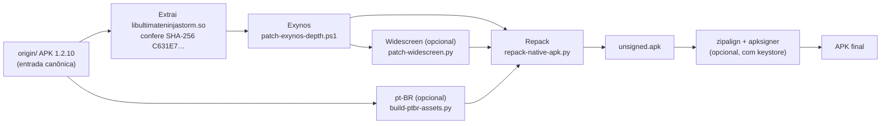
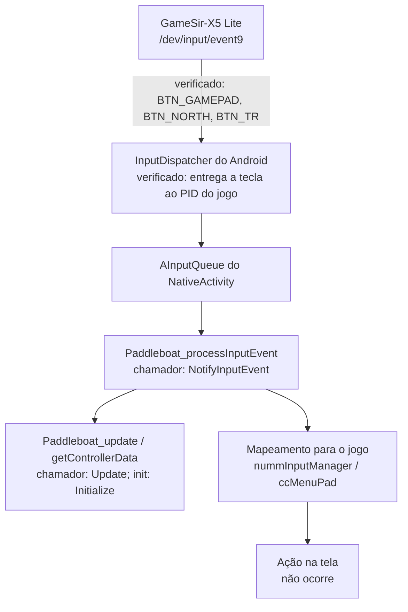

# Arquitetura

Escrito para: quem vai alterar os scripts de patch, investigar o binário nativo ou montar uma nova build.

## 1. Visão geral

O projeto não compila o jogo. Ele **modifica o APK 1.2.10 original** em etapas, cada uma com entrada e saída verificadas, e empacota o resultado.

## 2. Componentes

| Componente | Caminho | Responsabilidade |
|---|---|---|
| Orquestrador | `scripts/build-selective.py` | Escolhe os ajustes, chama as etapas, grava o manifesto `selective-build.json`. |
| Patch Exynos | `scripts/patch-exynos-depth.ps1` | Altera 1 byte da tabela de formatos de imagem, no offset do Build ID. |
| Patch widescreen | `scripts/patch-widescreen.py`, `patches/widescreen/stubs.S` | Insere código nativo para resolução, câmera e conversão de toque. |
| Textos pt-BR | `scripts/build-ptbr-assets.py`, `patches/ptbr/catalogs/` | Gera os arquivos de mensagem e letreiros substituídos no CPK. |
| Repacker APK | `scripts/repack-native-apk.py` | Troca só a biblioteca e os membros de substituição; confere CRC de todo o restante. |
| Repacker CPK | `scripts/patch-cpk.py` | Atualiza TOC e tamanho de conteúdo dos pacotes de áudio/dados. |
| Testes | `scripts/test-*.py` | Validam guardas e a composição do widescreen. |
| Entrada | `origin/` | APK original. Ignorada pelo Git. |
| Saída aceita | `build/` | Único APK aceito no S24. Ignorado pelo Git. |
| Trabalho | `work/` | Insumos, candidatos, análises e chave de assinatura. Ignorada pelo Git. |
| Evidência | `audit/`, `docs/` | Frames de referência e documentação. |

## 3. Invariantes

Estas regras valem para todo patch novo:

1. **Entrada identificada.** Antes de alterar, o script confere o SHA-256 da biblioteca ou o Build ID. Se não bater, aborta.
2. **Bytes esperados.** Antes de gravar, confere o valor que está no offset. Se for diferente, aborta.
3. **Intermediários isolados e limpos.** Cada etapa grava em `work/build-tmp-*`, que é apagada ao fim da execução. Só o APK final é publicado, substituindo o anterior em `build/` (ou no `--output` informado). A troca é feita por arquivo `.partial` seguido de `os.replace`.
4. **Releitura.** Depois de gravar, lê o arquivo de novo e confere o hash.
5. **Manifesto.** Cada saída tem um `.patch.json` com o hash de entrada e de saída. O repacker lê esse manifesto e recusa biblioteca sem ele.
6. **Original intacto.** `origin/` e `original/` nunca são alterados.

## 4. Fluxo de dados

- `build-selective.py` extrai `lib/arm64-v8a/libultimateninjastorm.so` do APK original, na pasta de build.
- Cada etapa lê a saída anterior. Exynos é a base; widescreen parte do Exynos.
- O pt-BR é independente da biblioteca. Gera um `apk-plan.json`, que o repacker aplica junto com a biblioteca final.
- O repacker valida o hash da biblioteca contra o manifesto e grava um APK novo com todos os demais membros preservados (mesmo CRC e tamanho).
- A assinatura é uma etapa final opcional: `zipalign -P 16 -f 4`, depois `apksigner sign` e `apksigner verify`.

## 5. Biblioteca nativa

- `libultimateninjastorm.so`: ELF64 arm64, Build ID `c3e506f9be350dfb4a00c79228754028` para as versões analisadas.
- A biblioteca recebida tem SHA-256 `C631E7…`, mesmo Build ID do conjunto anterior, mas bytes diferentes. Por isso a identidade é conferida pelo hash completo, não só pelo Build ID.
- O engine é **cc2 / mmEngine**, em `NativeActivity`. Não há código-fonte; trabalho é por análise de binário.
- Símbolos úteis: `Paddleboat_*` (Google Game Controller, versão 1.1.0), `nummInputManager`, `ccMenuPad`, `ccScreenInputManager`, `ccTouchButton`, `ccGestureTouchButton`.

## 6. Caminho da entrada do controle

Mapa do caminho de um botão do GameSir-X5 Lite até a tela:

Estado de cada elo:

| Elo | Estado |
|---|---|
| Driver e evdev | Verificado: eventos corretos no Linux. |
| InputDispatcher | Verificado: tecla entregue ao processo do jogo; depois, fila acumulada ("unprocessed events"). |
| Chamadas Paddleboat | Existem no binário: `init` em `Initialize`, `update` em `Update`, `processInputEvent` em `NotifyInputEvent`. |
| Ordem e condições de chamada | **Não verificado.** Falta confirmar o chamador de `NotifyInputEvent` e se `Initialize` retorna sucesso. |
| Mapeamento e ação | **Não verificado.** `IsControllerConnected` não tem chamada direta; é consultado por ponteiro virtual, e o chamador ainda não foi identificado. |

Hipótese de trabalho para a tela de toque: o motor pode esconder os botões de toque quando detecta controle conectado. Não está comprovada.

## 7. Módulos de análise

- Ghidra headless com `work/tools/RatioXrefs.java`, em projeto novo dentro de `work/`.
- Varredura de instruções ARM64 em Python (`BL`/`B`) para encontrar chamadas diretas, sem Ghidra.
- ADB para logs e para `getevent`, com o aparelho em Depuração sem fio.

## 8. Decisões

- **Biblioteca de controle externa não é adicionada.** O binário já contém a Paddleboat; o trabalho é garantir que o jogo a use.
- **Sem refatoração do engine.** O projeto é um patch sobre o binário; cada mudança é pequena e isolada.
- **Exynos é sempre incluído.** Widescreen depende dele, e a cadeia de pt-BR isolada não foi validada.
- **Controle externo bloqueado no orquestrador.** A opção existe para deixar a limitação explícita.

## 9. Pontos em aberto

1. Confirmar o chamador de `NotifyInputEvent` e o retorno de `Initialize` (Ghidra em andamento).
2. Identificar o chamador do slot de vtable de `IsControllerConnected`.
3. Se o controle for entregue e não gerar ação, localizar o consumo nativo da fila.
4. Testar a assinatura do orquestrador com um keystore real.
